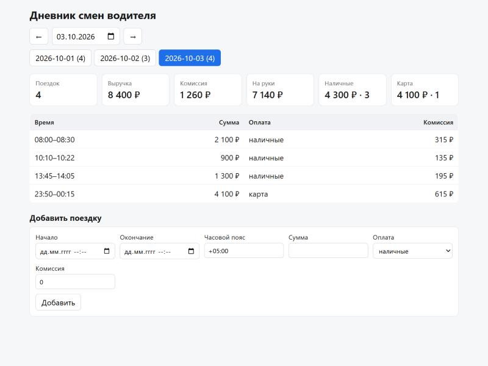

# Дневник смен водителя

Мини-проект: сервер на FastAPI отдаёт поездки водителя и сводку за день,
принимает новые поездки с валидацией и защитой от дублей; одностраничный
клиент показывает сводку, список поездок и переключает дни.



## Запуск

Нужен Python 3.11+.

```bash
python -m venv .venv
.venv\Scripts\activate        # Windows; на macOS/Linux: source .venv/bin/activate
pip install -r requirements.txt
python -m uvicorn app.main:app
```

Откройте <http://localhost:8000>. Схема API — <http://localhost:8000/docs>.

Данные лежат в `data/trips.json`; при первом запуске файл создаётся из
`data/seed.json` (11 поездок за 1–3 октября 2026). Чтобы начать заново —
удалите `data/trips.json`. Другой файл: `TRIPS_FILE=/path/to/trips.json`.

## Тесты

```bash
python -m pytest
```

Покрыты: расчёт сводки (в т.ч. пустой день, поездка через полночь, разные
часовые пояса, точное сложение копеек), защита от дублей (по `id`, по
содержимому, конфликт `id`, параллельные добавления (потоки)), валидация и API.

## API

| метод | путь                         | ответ |
|-------|------------------------------|-------|
| GET   | `/api/days`                  | дни с поездками: `[{"date": "2026-10-01", "trips_count": 4}, …]` |
| GET   | `/api/trips?date=2026-10-01` | поездки за день, по времени начала |
| GET   | `/api/summary?date=2026-10-01` | сводка за день |
| POST  | `/api/trips`                 | `201` создана · `200` уже есть · `409` конфликт `id` · `422` невалидно |

Сводка:

```json
{
  "date": "2026-10-01", "trips_count": 4,
  "revenue": 8080, "commission": 1212, "net": 6868,
  "by_payment": {"cash": {"count": 2, "amount": 2480}, "card": {"count": 2, "amount": 5600}}
}
```

Добавить поездку (`id` необязателен — без него сервер сгенерирует UUID):

```bash
curl -X POST http://localhost:8000/api/trips -H "Content-Type: application/json" \
  -d '{"id":"demo-1","start":"2026-10-05T08:10:00+05:00","end":"2026-10-05T08:32:00+05:00","amount":2400,"payment":"card","commission":360}'
```

Повторный такой же запрос вернёт `200` и ту же запись.

Тот же `id` с другими данными — `409` и существующая запись в ответе:

```bash
curl -X POST http://localhost:8000/api/trips -H "Content-Type: application/json" \
  -d '{"id":"demo-1","start":"2026-10-05T08:10:00+05:00","end":"2026-10-05T08:32:00+05:00","amount":2500,"payment":"card","commission":360}'
```

`amount: 0`, `end <= start`, дата без часового пояса, лишнее поле — `422`.

## Что сделано и почему так

- **День поездки** — дата `start` в часовом поясе самой метки (`+05:00`),
  без пересчёта в UTC: день водителя совпадает с его локальным днём.
  Поездка через полночь относится к дню начала.
- **Дубли** — одно правило: поездка считается той же, если совпал `id`
  *или* содержимое (`start`, `end`, `amount`, `payment`, `commission`).
  Точный повтор → `200` (клиент, переотправивший запрос после обрыва сети,
  получает успех); тот же `id` с другим содержимым → `409`, чтобы подмена
  не терялась молча.
- **Деньги** — `Decimal` до копеек, суммы считаются точно, без округления.
  В JSON — числом, как в примере задания (`2400`, `2400.5`).
- **Хранение** — JSON-файл, как в задании. Список в памяти, каждая запись
  переписывает файл атомарно (временный файл + `os.replace`), всё под одним
  `Lock`. Один процесс, один воркер; файл не редактировать на лету.
- **Клиент** — один HTML-файл без сборки. Данные в DOM только через
  `textContent`; время берётся из ISO-строки, а не через `new Date`, чтобы не
  сдвигалось в пояс браузера.

Допущения сверх задания: `commission <= amount`, `commission >= 0`,
`id` — `[A-Za-z0-9_-]{1,64}`, суммы до 12 знаков; многодневные поездки
допустимы; часовой пояс в датах обязателен.

## Что не сделано

Авторизация, лимит размера тела запроса, база данных, редактирование и
удаление поездок, пагинация, Docker, несколько воркеров — не требуется
заданием и усложнило бы чтение.
